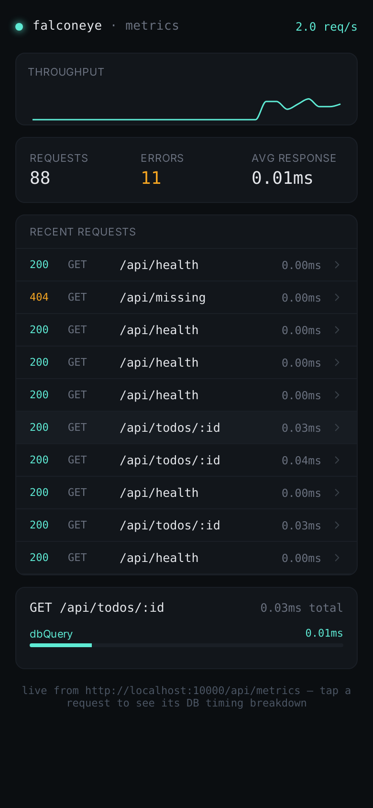

<p align="center">
  
</p>

<p align="center">
  
  
  
  
</p>

<p align="center">
  
</p>

<p align="center"><sub><b>CI / CD</b></sub></p>
<p align="center">
  <a href="https://github.com/privateMwb/FalconEye/actions/workflows/build.yml">
    
  </a>
  <a href="https://github.com/privateMwb/FalconEye/actions/workflows/frontend.yml">
    
  </a>
  <a href="https://github.com/privateMwb/FalconEye/actions/workflows/demo-image.yml">
    
  </a>
  <a href="https://github.com/privateMwb/FalconEye/actions/workflows/release.yml">
    
  </a>
</p>

<p align="center"><sub><b>Code Quality &amp; Safety</b></sub></p>
<p align="center">
  <a href="https://github.com/privateMwb/FalconEye/actions/workflows/sanitizers.yml">
    
  </a>
  <a href="https://github.com/privateMwb/FalconEye/actions/workflows/clang-tidy.yml">
    
  </a>
  <a href="https://github.com/privateMwb/FalconEye/actions/workflows/clang-format.yml">
    
  </a>
  <a href="https://github.com/privateMwb/FalconEye/actions/workflows/codeql.yml">
    
  </a>
  <a href="https://github.com/privateMwb/FalconEye/actions/workflows/cflite_pr.yml">
    
  </a>
</p>

<p align="center"><sub><b>Documentation</b></sub></p>
<p align="center">
  <a href="https://github.com/privateMwb/FalconEye/actions/workflows/docs.yml">
    
  </a>
</p>

<p align="center">
  
</p>

<p align="center">FalconEye is a live observability dashboard for <a href="https://github.com/privateMwb/FalconHTTP">FalconHTTP</a> servers. A <code>Metrics</code> middleware records per-request and per-database-call timing, a JSON endpoint serves it, and a React dashboard shows throughput, error counts, and a timing breakdown for every request. The dashboard only depends on the <code>/api/metrics</code> JSON shape, so it can show any backend that serves it.</p>

<p align="center">
  
</p>

<br>

> [!NOTE]
> **Status: v1.0.0, plus tests, fuzzing and a hosted-demo setup.** The middleware, the
> `/api/metrics` endpoint and the dashboard are complete, with unit tests, sanitizer runs
> (ASan, UBSan, TSan) and ClusterFuzzLite fuzzing behind them. The Docker image and the
> Render + Vercel setup have a CI check (the `Demo image` workflow) but are **not deployed
> yet**: deploy them from your own accounts (see [Deployment](#deployment)). Linux only so far.

<br>

## 📑 Table of Contents

- [Features](#features)
- [How It Works](#how-it-works)
- [Requirements](#requirements)
- [Stack](#stack)
- [Installation](#installation)
- [Quick Start](#quick-start)
- [Running the Demo](#running-the-demo)
- [Dashboard](#dashboard)
- [Metrics API](#metrics-api)
- [Live Metrics](#live-metrics)
- [Docker](#docker)
- [Deployment](#deployment)
- [Project Structure](#project-structure)
- [Roadmap](#roadmap)
- [Design Notes](#design-notes)
- [Development](#development)
- [Documentation](#documentation)
- [Contributing](#contributing)
- [Changelog](#changelog)
- [Security](#security)
- [License](#license)

<br>

## <a id="features"></a>✨ Features

- **Onion-model request timing** — `Metrics` wraps `next()` in FalconHTTP's middleware chain, timing the whole request/response cycle including the matched route handler. It is registered last, so nothing downstream of it goes unmeasured.
- **Route patterns, not raw paths** — each entry reports `/api/todos/:id`, not `/api/todos/42`, by re-running FalconHTTP's own `PathMatcher::match()` against the live `Router`. No changes to FalconHTTP's source.
- **Per-request database timing** — `timedCall()` wraps a MiniDB call where the route handler makes it and adds the result to that request's `breakdown`, through a thread-local pointer scoped by `Metrics` around each request. No changes to MiniDB's source.
- **Thread-safe, bounded memory** — a fixed-capacity ring buffer (50 entries by default, oldest overwritten) behind one mutex, because requests run on a thread pool and concurrent writes are the normal case.
- **Exceptions don't lose data** — a handler that throws is still recorded before the exception reaches `Recovery`.
- **No feedback loop** — the dashboard's own polling of `/api/metrics` is never recorded, so it can't crowd out real traffic or skew the numbers.
- **A live dashboard, not a static export** — the React page polls every 3 seconds and shows a requests-per-second sparkline, summary stats, a scrollable request log, and a tap-to-open timing breakdown per request.
- **Backend-agnostic frontend** — the dashboard reads one JSON shape, nothing FalconHTTP-specific, so any server that serves `/api/metrics` in that shape works with it.
- **Built to run on a phone** — the dashboard is a single column that reads well on a small screen.
- **Tested, sanitized and fuzzed** — unit tests for the ring buffer, the JSON output and `timedCall()`; ASan, UBSan and TSan runs against the real server; ClusterFuzzLite harnesses on the serialization path.
- **Ready to host** — a Docker image with its own traffic generator and a read-only front door, plus a Render blueprint and Vercel config.
- **Built on its author's own libraries** — the HTTP server and the embedded database are FalconHTTP and MiniDatabase, both vendored in the repository (see [Stack](#stack)).

<div align="right"><a href="#-table-of-contents"></a></div>

## <a id="how-it-works"></a>🧠 How It Works

```
 client ──► FalconHTTP server ──► Recovery ──► Logger ──► Cors ──► Metrics ──► route handler
                                                                      │             │
                                         starts a timer and points    │             │ timedCall("dbQuery", ...)
                                         the thread-local breakdown   │             │ adds a step to the current
                                         at this request's vector     │             │ request's breakdown
                                                                      ▼             ▼
                                                              MetricsRingBuffer (mutex, 50 entries)
                                                                      │
                          GET /api/metrics ──► metricsToJson() ◄──────┘
                                  │
                                  ▼
                         React dashboard (polls every 3 s)
```

1. **`Metrics` is the last middleware**, so its timer covers the handler and everything the handler calls.
2. **Before the handler runs**, `Metrics` points a thread-local pointer at a fresh `breakdown` vector. `timedCall()` appends to whatever that pointer addresses, so two requests on two threads never mix their steps.
3. **After the handler returns, or throws**, `Metrics` builds a `MetricEntry` (matched route pattern, method, status, total time, UTC timestamp, breakdown) and pushes it into the ring buffer.
4. **`GET /api/metrics`** serializes the buffer, oldest entry first. That route is excluded from recording, so polling never feeds back into the numbers.
5. **The dashboard** polls the endpoint every 3 seconds and works out requests per second from how much `requestCount` grew.

<div align="right"><a href="#-table-of-contents"></a></div>

## <a id="requirements"></a>📋 Requirements

- A C++23 compiler: GCC or Clang on Linux (nothing else has been tested)
- CMake 3.20+
- Node.js 20+ and npm for the dashboard (Node.js 22 for the demo scripts' tests)
- Docker, only if you want to build the demo image
- Nothing else to fetch: FalconHTTP and MiniDatabase are committed under `backend/external/`

<div align="right"><a href="#-table-of-contents"></a></div>

## <a id="stack"></a>🔗 Stack

| Layer | Technology |
|---|---|
| HTTP server, router, middleware | [FalconHTTP](https://github.com/privateMwb/FalconHTTP), vendored in `backend/external/falconhttp/` |
| Embedded database (what `timedCall()` times) | [MiniDatabase](https://github.com/privateMwb/MiniDatabase), vendored in `backend/external/minidb/` |
| Metrics middleware | C++23, header-only (`backend/include/`) |
| Dashboard | React 18, Vite, lucide-react |
| Hosted-demo front door | Node.js, no npm dependencies (`scripts/demo-server.mjs`) |

Both libraries are built from source with `add_subdirectory()`. There is no package manager step, since each one already vendors its own dependencies.

<div align="right"><a href="#-table-of-contents"></a></div>

## <a id="installation"></a>📦 Installation

```bash
git clone https://github.com/privateMwb/FalconEye.git
cd FalconEye

# Backend
cd backend
cmake -B build
cmake --build build

# Dashboard, in another terminal
cd ../frontend
npm install
```

<div align="right"><a href="#-table-of-contents"></a></div>

## <a id="quick-start"></a>🚀 Quick Start

Wiring `Metrics` into a FalconHTTP server:

```cpp
#include <FalconHTTP/Core/Server.h>
#include <FalconHTTP/Routing/Router.h>
#include "Metrics.h"
#include "MetricsJson.h"

FalconHTTP::Routing::Router router;
// ... register your own routes on router ...

Metrics metrics(router, /*bufferCapacity=*/50); // must be at least 1

router.get("/api/metrics", [&metrics](const auto&, auto& response) {
    response.setJson(metricsToJson(metrics));
});

FalconHTTP::Core::Server server(router, /*threadCount=*/4);
server.use(FalconHTTP::Middleware::Recovery{});
server.use(FalconHTTP::Middleware::Logger{});
server.use(metrics); // last, so it captures the full request including the handler

server.start(8080);
server.run();
```

Timing a database call inside a route handler:

```cpp
#include "DbTiming.h"

router.get("/api/todos/:id", [&](const auto& request, auto& response) {
    auto id = std::stoul(request.pathParam("id"));

    auto result = timedCall("dbQuery", [&]() {
        return queryEngine.selectByID(*table, id);
    });
    // the call's duration now appears in this request's `breakdown`
});
```

<div align="right"><a href="#-table-of-contents"></a></div>

## <a id="running-the-demo"></a>▶️ Running the Demo

Three terminals give you a live dashboard on your own machine:

```bash
# Terminal 1: the example server on :8080
cd backend && ./build/falconeye_server

# Terminal 2: the dashboard on http://localhost:5173
cd frontend && npm run dev

# Terminal 3: some traffic (the example routes record data only when called)
while true; do
  curl -s localhost:8080/api/health > /dev/null
  curl -s localhost:8080/api/todos/1 > /dev/null
  curl -s localhost:8080/api/todos/99 > /dev/null   # 404: counts as an error
  sleep 0.3
done
```

Open `http://localhost:5173` and watch the sparkline move. Stop the server and the dashboard keeps its last data and shows that it lost the connection; start it again and it recovers on the next poll. A guided tour is in [docs/DEMO.md](docs/DEMO.md).

<div align="right"><a href="#-table-of-contents"></a></div>

## <a id="dashboard"></a>🖥️ Dashboard

A single-column React page that works on a phone as well as a desktop:

- **Header** — a live or connection-lost indicator and the current requests per second.
- **Throughput** — a sparkline of requests per second over the last 30 polls (about 90 seconds).
- **Summary** — total requests, errors in the buffered window, and average response time.
- **Recent requests** — status, method, matched route and duration, newest first. Tap one to see its database timing breakdown.
- **Connection lost** — if a poll fails, the page keeps the last data it had and shows the URL it could not reach.

**Pointing it at a server.** It reads `http://localhost:8080/api/metrics` by default. Override that per build with `VITE_DEFAULT_TARGET` (for example `https://falconeye-demo.onrender.com`), or per visit with `?target=<base url>`. The server's `Cors` middleware must allow the dashboard's origin; the example server allows `http://localhost:5173`.

<div align="right"><a href="#-table-of-contents"></a></div>

## <a id="metrics-api"></a>🔌 Metrics API

`GET /api/metrics` returns:

```json
{
  "requestCount": 214,
  "errorCount": 3,
  "avgResponseMs": 4.82,
  "recentRequests": [
    {
      "route": "/api/todos/:id",
      "method": "GET",
      "status": 200,
      "totalMs": 12.48,
      "timestamp": "2026-08-11T09:41:02Z",
      "breakdown": [{ "name": "dbQuery", "ms": 9.11 }]
    }
  ]
}
```

| Field | Meaning |
|---|---|
| `requestCount` | Lifetime total of recorded requests, not capped by the buffer. |
| `errorCount` | Requests with status `>= 400` **within the buffered window only**. |
| `avgResponseMs` | Mean `totalMs` over the buffered window. |
| `recentRequests` | The buffered entries, oldest first. |
| `route` | The matched route *pattern*, not the raw path. |
| `breakdown` | Steps added by `timedCall()`; an empty array when the handler timed nothing. |

`/api/health` and `/api/todos/:id` are example routes in `backend/src/routes/ExampleRoutes.h`, there to give the dashboard something to show.

<div align="right"><a href="#-table-of-contents"></a></div>

## <a id="live-metrics"></a>📡 Live Metrics

The dashboard polls; nothing is pushed. Every 3 seconds it fetches `/api/metrics` and:

- **Derives throughput.** The server keeps no history of requests per second, so the page computes `(requestCount − previous requestCount) ÷ 3 s` and keeps the last 30 values for the sparkline.
- **Keeps working through a failed poll.** On an error it keeps the previous data, marks the connection as lost, and tries again on the next tick.
- **Reads two kinds of number.** `requestCount` is a lifetime total; `errorCount` and `avgResponseMs` describe only the last 50 requests, so an error scrolls out of the count once 50 newer requests have arrived.

```bash
curl -s localhost:8080/api/metrics | head -c 400
```

Polling costs one small JSON response per interval and needs no long-lived connection, which keeps the server side to a single route. The trade-off is that a burst shorter than the poll interval is averaged away in the sparkline; the request log still lists every request that is still in the buffer.

<div align="right"><a href="#-table-of-contents"></a></div>

## <a id="docker"></a>🐳 Docker

`Dockerfile.demo` builds one image that runs the whole demo backend: the real `falconeye_server`, a traffic generator that keeps the metrics moving, and a read-only front door on a single public port (`10000` by default).

```bash
docker build -f Dockerfile.demo -t falconeye-demo .
docker run --rm -p 10000:10000 -e ALLOWED_ORIGINS=http://localhost:5173 falconeye-demo
scripts/check-demo.sh http://localhost:10000 http://localhost:5173
```

The front door forwards only `GET /api/metrics` and `GET /api/health`, answers `/healthz` itself, and sets CORS headers only for the origins in `ALLOWED_ORIGINS`. The container runs as an unprivileged user and keeps everything in memory. The `Demo image` workflow builds this image and runs `check-demo.sh` against it on every relevant change.

The C++ server is unchanged inside the container: its port and its CORS origin stay hard-coded in `main.cpp`, which is why the front door exists. There is no Docker Compose file, because the demo is a single container and the dashboard is hosted separately.

<div align="right"><a href="#-table-of-contents"></a></div>

## <a id="deployment"></a>☁️ Deployment

A hosted demo is a Render service for the backend and a Vercel project for the dashboard:

- **Render (backend)** — `render.yaml` builds `Dockerfile.demo`.
- **Vercel (dashboard)** — import the repo with Root Directory `frontend` and set `VITE_DEFAULT_TARGET` to your Render URL.

```bash
# Render:  New → Blueprint, pick this repo (render.yaml), then set ALLOWED_ORIGINS
# Vercel:  import the repo, Root Directory = frontend, set VITE_DEFAULT_TARGET
scripts/check-demo.sh https://<your-service>.onrender.com https://<your-dashboard>.vercel.app
```

> [!NOTE]
> On Render's free plan the service sleeps when idle. The first visit afterwards takes about a minute, and the metrics start again from zero.

The step-by-step guide is in [docs/DEPLOYMENT.md](docs/DEPLOYMENT.md). Nothing has been deployed from this repository yet, so expect to fix small things on the first run.

<div align="right"><a href="#-table-of-contents"></a></div>

## <a id="project-structure"></a>🗂️ Project Structure

```
FalconEye/
├── backend/
│   ├── include/
│   │   ├── Metrics.h
│   │   ├── DbTiming.h
│   │   └── MetricsJson.h
│   ├── src/
│   │   ├── main.cpp
│   │   └── routes/
│   │       └── ExampleRoutes.h
│   ├── tests/
│   │   ├── suite/unit/
│   │   ├── support/
│   │   └── test_main.cpp
│   ├── fuzz/
│   │   ├── corpus/
│   │   ├── fuzz_metrics_json.cpp
│   │   └── fuzz_db_timing.cpp
│   ├── external/
│   │   ├── falconhttp/
│   │   └── minidb/
│   └── CMakeLists.txt
│
├── frontend/
│   ├── src/
│   │   ├── main.jsx
│   │   ├── App.jsx
│   │   └── index.css
│   ├── index.html
│   ├── package.json
│   ├── vercel.json
│   └── vite.config.js
│
├── scripts/
│   ├── demo-server.mjs
│   ├── check-demo.sh
│   ├── capture-screenshots.mjs
│   └── tests/
│
├── docs/
│   ├── ARCHITECTURE.md
│   ├── DEMO.md
│   ├── DEPLOYMENT.md
│   ├── Doxyfile
│   └── images/
│       └── dashboard.png
│
├── .clusterfuzzlite/
├── .github/
│   ├── assets/
│   ├── releases/
│   ├── workflows/
│   ├── CODEOWNERS
│   └── dependabot.yml
│
├── Dockerfile.demo
├── render.yaml
├── CHANGELOG.md
├── CONTRIBUTING.md
├── SECURITY.md
├── .clang-format
├── .clang-tidy
├── .gitignore
├── README.md
└── LICENSE
```

<div align="right"><a href="#-table-of-contents"></a></div>

## <a id="roadmap"></a>🗺️ Roadmap

Ideas, not commitments. These are the gaps that exist today:

- [ ] **Reject a buffer capacity of 0.** `Metrics(router, 0)` is not validated, and a zero-sized ring buffer divides by zero on the first push.
- [ ] **Per-middleware timing.** `breakdown` only holds calls wrapped with `timedCall()`; `Recovery`, `Logger` and `Cors` live in the untouched FalconHTTP library and can't report their own time.
- [ ] **Percentiles.** Show p50, p95 and p99 latency next to the average.
- [ ] **Authentication for `/api/metrics`**, or a documented reverse-proxy recipe.
- [ ] **Configurable buffer size and poll interval** without recompiling or rebuilding.
- [ ] **Other backends.** The dashboard already works with anything that serves the JSON shape; a second middleware implementation would prove it.
- [ ] **macOS and Windows.** Everything here has only been built and run on Linux.
- [ ] **Code coverage reporting** for the unit tests.
- [ ] **Real git submodules** for FalconHTTP and MiniDatabase, instead of committed copies.

<div align="right"><a href="#-table-of-contents"></a></div>

## <a id="design-notes"></a>🔬 Design Notes

**Why `Metrics` is registered last.** Middleware runs in an onion: the last one registered sits closest to the handler. Putting `Metrics` there means its timer covers the handler and anything it calls, while `Recovery` and `Logger` stay outside it.

**Why a thread-local pointer.** A thread pool runs many requests at once, but one request stays on one thread from `Metrics` through its handler. A thread-local pointer lets `timedCall()` find "the current request" without threading an argument through every call, and two requests can never write into each other's breakdown (the `threads_do_not_share_a_breakdown` test checks this).

**Why the route pattern is recovered, not read.** Recording `/api/todos/42` would give every id its own row. Rather than change FalconHTTP, `Metrics` re-runs `PathMatcher::match()` against the router's registered routes. That costs one extra match per request and needs no change to FalconHTTP.

**Why one mutex.** Every worker thread writes, and `/api/metrics` reads. The critical section is a copy into a slot plus two integer updates, so a single mutex is simple and cheap at this scale. A lock-free queue would be harder to get right for no measurable gain here.

**Why two kinds of counter.** `requestCount` is a lifetime atomic total. `errorCount` and `avgResponseMs` come from the buffered window. They answer different questions (how many ever, and how healthy lately), and the dashboard labels them accordingly.

**Why the demo has a front door.** The C++ server hard-codes its port and one CORS origin. Rather than change it, `scripts/demo-server.mjs` listens on the public port, answers CORS for the dashboard's real origin, and exposes only the two read-only routes. It is a few dozen lines of Node with no dependencies.

**Why polling.** One route and one JSON shape keep the server side trivial and make the dashboard backend-agnostic. The cost is a 3-second resolution, which is why the request log, not the sparkline, is the place to look at individual requests.

<div align="right"><a href="#-table-of-contents"></a></div>

## <a id="development"></a>🛠️ Development

**Build and test the backend** (Debug by default):

```bash
cd backend
cmake -B build -DCMAKE_BUILD_TYPE=Debug
cmake --build build
./build/falconeye_tests            # all suites
./build/falconeye_tests list       # list the suites
```

**Run the dashboard dev server:**

```bash
cd frontend
npm run dev
```

**Run the demo scripts' tests:**

```bash
node --test scripts/tests/*.test.mjs
```

**Check formatting and static analysis locally**, the same checks CI runs:

```bash
find backend/include backend/src \( -name "*.h" -o -name "*.cpp" \) -exec clang-format --dry-run --Werror {} +
clang-tidy -p backend/build $(find backend/include backend/src -name "*.h" -o -name "*.cpp")
```

**Fuzz harnesses** are `backend/fuzz/fuzz_<target>.cpp`. Each file becomes its own binary with no build-file edit, and its seed inputs go in `backend/fuzz/corpus/fuzz_<target>/`. ClusterFuzzLite runs them for a few minutes on pull requests and for longer every night.

| Layer | What it covers |
|---|---|
| Unit tests | Ring buffer order, wraparound and concurrency; the JSON shape and text round-trips; `timedCall()` and its per-thread isolation |
| Sanitizers | The real server under ASan + UBSan, then TSan, hit with real requests |
| Fuzzing | The metrics serialization path and `timedCall()` |
| Static analysis | clang-tidy and CodeQL |
| Demo check | `scripts/check-demo.sh` against a running demo |

<div align="right"><a href="#-table-of-contents"></a></div>

## <a id="documentation"></a>📖 Documentation

Full API reference, generated with Doxygen from `docs/Doxyfile`:

**https://privateMwb.github.io/FalconEye/**

Guides in [`docs/`](docs/):

- [Architecture](docs/ARCHITECTURE.md) — the request path, the thread-local breakdown, and the design choices behind them
- [Demo](docs/DEMO.md) — a short tour of the dashboard
- [Deployment](docs/DEPLOYMENT.md) — the Render + Vercel setup, step by step

<div align="right"><a href="#-table-of-contents"></a></div>

## <a id="contributing"></a>🤝 Contributing

Issues and pull requests are welcome. See [CONTRIBUTING.md](CONTRIBUTING.md) for the workflow and the checks. In short: run `clang-format`, `clang-tidy` and the test suite locally (see [Development](#development)); CI enforces all three.

<div align="right"><a href="#-table-of-contents"></a></div>

## <a id="changelog"></a>📝 Changelog

See [CHANGELOG.md](CHANGELOG.md), and the [Releases](https://github.com/privateMwb/FalconEye/releases) page for release notes.

<div align="right"><a href="#-table-of-contents"></a></div>

## <a id="security"></a>🔒 Security

FalconEye is a development and demonstration tool: `/api/metrics` has no authentication or encryption. Read [SECURITY.md](SECURITY.md) before exposing it, and report suspected vulnerabilities privately through the repository's **Security** tab.

<div align="right"><a href="#-table-of-contents"></a></div>

## <a id="license"></a>📄 License

MIT — see [LICENSE](LICENSE) for details.

<p align="center">
  <sub>Built with C++23 and React</sub>
</p>

<p align="center">
  <a href="#-table-of-contents"></a>
</p>
