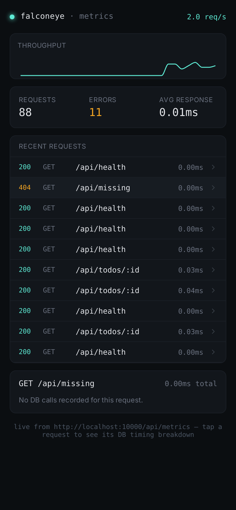
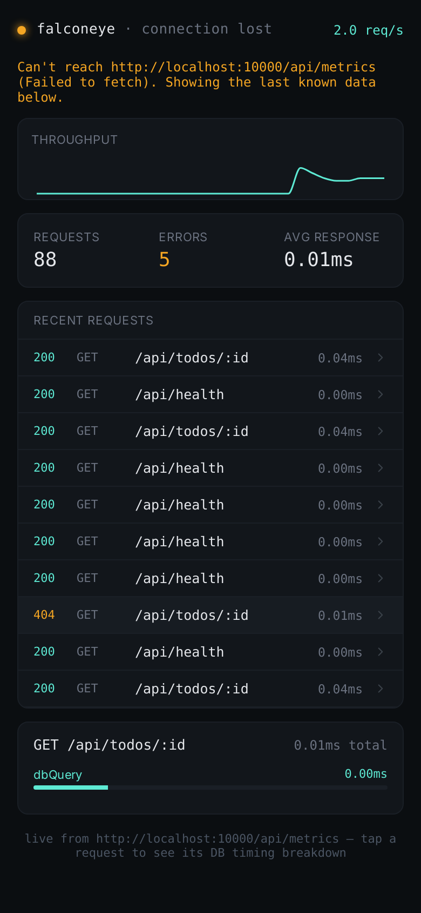
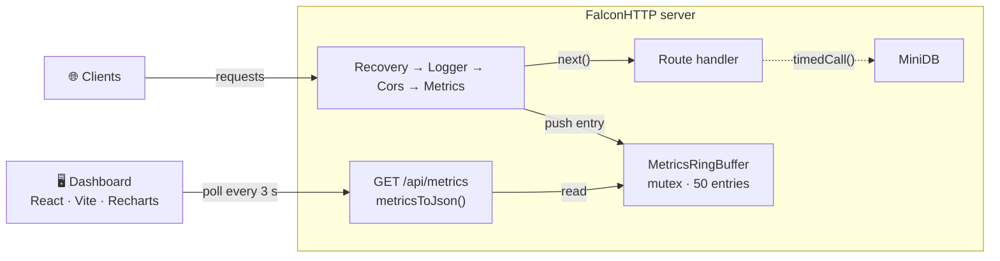
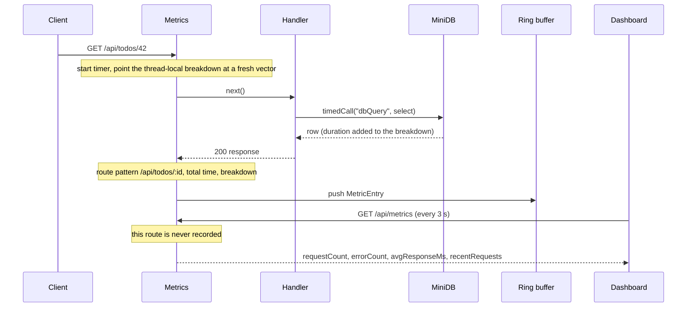

<p align="center">
  
</p>

<p align="center">
  
  
  
  
</p>

<p align="center">
  
</p>

<p align="center"><sub><b>CI / CD</b></sub></p>
<p align="center">
  <a href="https://github.com/privateMwb/FalconEye/actions/workflows/build.yml">
    
  </a>
  <a href="https://github.com/privateMwb/FalconEye/actions/workflows/frontend.yml">
    
  </a>
  <a href="https://github.com/privateMwb/FalconEye/actions/workflows/demo-image.yml">
    
  </a>
  <a href="https://github.com/privateMwb/FalconEye/actions/workflows/release.yml">
    
  </a>
</p>

<p align="center"><sub><b>Code Quality &amp; Safety</b></sub></p>
<p align="center">
  <a href="https://github.com/privateMwb/FalconEye/actions/workflows/sanitizers.yml">
    
  </a>
  <a href="https://github.com/privateMwb/FalconEye/actions/workflows/clang-tidy.yml">
    
  </a>
  <a href="https://github.com/privateMwb/FalconEye/actions/workflows/clang-format.yml">
    
  </a>
  <a href="https://github.com/privateMwb/FalconEye/actions/workflows/codeql.yml">
    
  </a>
  <a href="https://github.com/privateMwb/FalconEye/actions/workflows/cflite_pr.yml">
    
  </a>
</p>

<p align="center"><sub><b>Documentation</b></sub></p>
<p align="center">
  <a href="https://github.com/privateMwb/FalconEye/actions/workflows/docs.yml">
    
  </a>
</p>

<p align="center">
  
</p>

<p align="center">FalconEye is a live observability dashboard for <a href="https://github.com/privateMwb/FalconHTTP">FalconHTTP</a> servers, paired with the C++ middleware that feeds it: a <code>Metrics</code> middleware times every request and every database call, a JSON endpoint serves the results, and a React dashboard shows throughput, errors, and a timing breakdown for each request <i>as it happens</i>. The dashboard reads one JSON shape, so it can show any backend that serves it.</p>

<br>

> [!NOTE]
> **Status: Phase 6 — complete.** The middleware times each request and each database call,
> `/api/metrics` serves them as JSON, and a responsive dashboard (desktop and phone) shows
> throughput, errors, and a per-request timing breakdown live. Unit tests, sanitizer runs, and
> fuzzing run in CI. The hosted-demo Docker image and the Render + Vercel setup are included but
> **not deployed yet** (see [Deployment](#deployment)). Linux only so far.

<p align="center">
  
</p>

<details>
<summary>More screenshots</summary>

<p align="center">
  
  
</p>

</details>

<br>

## 📑 Table of Contents

- [Features](#features)
- [How It Works](#how-it-works)
- [Requirements](#requirements)
- [Stack](#stack)
- [Installation](#installation)
- [Quick Start](#quick-start)
- [Running the Demo](#running-the-demo)
- [Dashboard](#dashboard)
- [Metrics API](#metrics-api)
- [Live Metrics](#live-metrics)
- [Docker](#docker)
- [Deployment](#deployment)
- [Project Structure](#project-structure)
- [Roadmap](#roadmap)
- [Design Notes](#design-notes)
- [Development](#development)
- [Documentation](#documentation)
- [Contributing](#contributing)
- [Changelog](#changelog)
- [Security](#security)
- [License](#license)

<br>

## <a id="features"></a>✨ Features

- **Onion-model request timing** — `Metrics` wraps `next()` in FalconHTTP's middleware chain, so its timer covers the whole request/response cycle including the matched route handler. It is registered last: nothing downstream of it goes unmeasured.
- **Route patterns, not raw paths** — each entry reports `/api/todos/:id`, not `/api/todos/42`, by re-running FalconHTTP's own `PathMatcher::match()` against the live `Router`. No changes to FalconHTTP's source.
- **Per-request database timing** — `timedCall()` wraps a MiniDB call where the route handler makes it and adds the result to that request's `breakdown`, through a thread-local pointer that `Metrics` scopes around each request. No changes to MiniDB's source.
- **Thread-safe, bounded memory** — a fixed-capacity ring buffer (50 entries by default, oldest overwritten) behind one mutex, because requests run on a thread pool and concurrent writes are the normal case, not an edge case.
- **Exceptions don't lose data** — a handler that throws is still recorded before the exception reaches `Recovery`.
- **No feedback loop** — the dashboard's own polling of `/api/metrics` is never recorded, so it can't crowd out real traffic or skew the numbers.
- **A live dashboard, not a static export** — the React page polls every 3 seconds and shows a requests-per-second sparkline, summary stats, a scrollable request log, and a tap-to-open timing breakdown per request.
- **A dashboard that tells the truth** — if a poll fails it keeps the last data, marks the connection as lost, and shows the exact URL it could not reach, instead of silently freezing or going blank.
- **Backend-agnostic frontend** — the dashboard depends only on the JSON shape, nothing FalconHTTP-specific, so any server that serves `/api/metrics` in that shape works with it.
- **Built to run on a phone** — the dashboard is a single responsive column that reads well on a small screen.
- **Tested, sanitized, and fuzzed** — unit tests for the ring buffer, the JSON output, and `timedCall()`; ASan, UBSan, and TSan runs against the real server; ClusterFuzzLite harnesses on the serialization path.
- **Ready to host** — a demo image with its own traffic generator and a read-only front door, a Render blueprint, and a Vercel config put the whole thing behind one URL, with the dashboard on Vercel (see [Deployment](#deployment)).
- **Built on its author's own libraries** — the HTTP server and the embedded database are FalconHTTP and MiniDatabase, both vendored in the repository (see [Stack](#stack)).

<div align="right"><a href="#-table-of-contents"></a></div>

## <a id="how-it-works"></a>🧠 How It Works

One server process runs FalconHTTP's middleware chain. `Metrics` sits last in it, times each request, and pushes the result into a ring buffer that `GET /api/metrics` serializes for the dashboard.



What happens to a single request:



The request path, the thread-local breakdown, and the trade-offs are written up in [docs/ARCHITECTURE.md](docs/ARCHITECTURE.md).

<div align="right"><a href="#-table-of-contents"></a></div>

## <a id="requirements"></a>📋 Requirements

- A C++23-conformant compiler (GCC or Clang on Linux) and CMake 3.20+
- Node.js 20+ for the dashboard (22 for the demo scripts' tests)
- Nothing to fetch: FalconHTTP and MiniDatabase are committed under `backend/external/`
- *(Optional)* Docker, to build the hosted-demo image

<div align="right"><a href="#-table-of-contents"></a></div>

## <a id="stack"></a>🔗 Stack

FalconEye is assembled from two libraries, vendored under `backend/external/`:

| Library | Namespace | Role |
|---|---|---|
| [FalconHTTP](https://github.com/privateMwb/FalconHTTP) | `FalconHTTP` | HTTP server, router, and the middleware chain `Metrics` is written against |
| [MiniDatabase](https://github.com/privateMwb/MiniDatabase) | `MiniDB` | The embedded database whose calls `timedCall()` times |

Both are built from source with `add_subdirectory()`; each one vendors its own dependencies, so there is no package manager step. The dashboard is **React 18**, **Vite**, **Recharts** and lucide-react, with no other runtime dependencies.

<div align="right"><a href="#-table-of-contents"></a></div>

## <a id="installation"></a>📦 Installation

Clone and build the backend:

```bash
git clone https://github.com/privateMwb/FalconEye
cd FalconEye/backend
cmake -S . -B build -DCMAKE_BUILD_TYPE=Release
cmake --build build
```

Then install the dashboard's dependencies, from the repository root:

```bash
npm --prefix frontend install
```

Everything lives in memory: there is nothing to initialize, and restarting the server clears the metrics.

<div align="right"><a href="#-table-of-contents"></a></div>

## <a id="quick-start"></a>🚀 Quick Start

The fastest way to see FalconEye work is the example server plus the dashboard. From the repository root, with the backend built:

```bash
./backend/build/falconeye_server        # the example server on http://localhost:8080
npm --prefix frontend run dev           # the dashboard on http://localhost:5173
```

Open <http://localhost:5173>, then send a few requests. The example routes record data only when something calls them:

```bash
for i in 1 2 3 4 5; do curl -s localhost:8080/api/health localhost:8080/api/todos/1 > /dev/null; done
```

Follow [docs/DEMO.md](docs/DEMO.md) for a short guided tour.

Prefer your own server? Wire `Metrics` into any FalconHTTP server:

```cpp
#include <FalconHTTP/Core/Server.h>
#include <FalconHTTP/Routing/Router.h>
#include "Metrics.h"
#include "MetricsJson.h"

FalconHTTP::Routing::Router router;
// ... register your own routes on router ...

Metrics metrics(router, /*bufferCapacity=*/50); // must be at least 1

router.get("/api/metrics", [&metrics](const auto&, auto& response) {
    response.setJson(metricsToJson(metrics));
});

FalconHTTP::Core::Server server(router, /*threadCount=*/4);
server.use(FalconHTTP::Middleware::Recovery{});
server.use(FalconHTTP::Middleware::Logger{});
server.use(metrics); // last, so it captures the full request including the handler

server.start(8080);
server.run();
```

And time a database call inside a route handler:

```cpp
#include "DbTiming.h"

router.get("/api/todos/:id", [&](const auto& request, auto& response) {
    auto id = std::stoul(request.pathParam("id"));

    auto result = timedCall("dbQuery", [&]() {
        return queryEngine.selectByID(*table, id);
    });
    // the call's duration now appears in this request's `breakdown`
});
```

<div align="right"><a href="#-table-of-contents"></a></div>

## <a id="running-the-demo"></a>▶️ Running the Demo

One terminal per process (from the repository root):

```bash
./backend/build/falconeye_server            # the server on :8080
npm --prefix frontend run dev               # the dashboard on :5173
while true; do                              # some traffic
  curl -s localhost:8080/api/health > /dev/null
  curl -s localhost:8080/api/todos/1 > /dev/null
  curl -s localhost:8080/api/todos/99 > /dev/null   # 404: counts as an error
  sleep 0.3
done
```

Watch the sparkline move, tap a `/api/todos/:id` row to see its `dbQuery` step, then stop the server: the dashboard keeps its last data and shows that it lost the connection. Start the server again and it recovers on the next poll.

The hosted demo wraps the same server in one container (see [Docker](#docker)). Its front door reads these environment variables:

| Variable | Purpose |
|---|---|
| `PORT` | The public port (default `10000`, what Render expects) |
| `ALLOWED_ORIGINS` | Comma-separated dashboard origins that get CORS headers; none by default |
| `FALCONEYE_BIN` | Path to the server binary (default `/app/falconeye_server`) |
| `TRAFFIC` | Set to `off` to stop the built-in traffic generator |

The dashboard has one build-time setting, `VITE_DEFAULT_TARGET` (the server's base URL), and one run-time override, `?target=<base url>`.

<div align="right"><a href="#-table-of-contents"></a></div>

## <a id="dashboard"></a>🖥️ Dashboard

```bash
npm --prefix frontend install
npm --prefix frontend run dev          # http://localhost:5173
```

<p align="center"></p>

**On a phone too:** the page is one column designed for a small screen. The easiest way to see it on a phone is the hosted demo (see [Deployment](#deployment)). Against a local server, the phone's origin would also have to be allowed by the server's `Cors` middleware, which `backend/src/main.cpp` limits to `http://localhost:5173`.

The dashboard reads `http://localhost:8080/api/metrics` by default; point it elsewhere with `VITE_DEFAULT_TARGET` at build time or `?target=` per visit.

| Element | What it shows |
|---|---|
| **Header** | A live or *connection lost* indicator, and the current requests per second |
| **Throughput** | A sparkline of requests per second over the last 30 polls (about 90 s) |
| **Summary** | Total requests, errors in the buffered window, and average response time |
| **Recent requests** | Status, method, matched route, and duration, newest first. Tap one for its breakdown |
| **Timing breakdown** | The steps `timedCall()` recorded for the selected request, each as a bar |
| **Connection lost** | The last data it had, plus the URL it could not reach |

<div align="right"><a href="#-table-of-contents"></a></div>

## <a id="metrics-api"></a>🔌 Metrics API

The server exposes one endpoint for the dashboard and two example routes to give it something to show:

```bash
curl localhost:8080/api/metrics        # the dashboard's data (never recorded itself)
curl localhost:8080/api/health         # example: fast, no database call
curl localhost:8080/api/todos/1        # example: one MiniDB call, so it has a breakdown
curl localhost:8080/api/todos/99       # example: 404, counts as an error
```

`GET /api/metrics` returns:

```json
{
  "requestCount": 214,
  "errorCount": 3,
  "avgResponseMs": 4.82,
  "recentRequests": [
    {
      "route": "/api/todos/:id",
      "method": "GET",
      "status": 200,
      "totalMs": 12.48,
      "timestamp": "2026-08-11T09:41:02Z",
      "breakdown": [{ "name": "dbQuery", "ms": 9.11 }]
    }
  ]
}
```

| Field | Meaning |
|---|---|
| `requestCount` | Lifetime total of recorded requests, not capped by the buffer |
| `errorCount` | Requests with status `>= 400` **within the buffered window only** |
| `avgResponseMs` | Mean `totalMs` over the buffered window |
| `recentRequests` | The buffered entries, oldest first |
| `route` | The matched route *pattern*, not the raw path |
| `breakdown` | Steps added by `timedCall()`; an empty array when the handler timed nothing |

| Status | Meaning |
|---|---|
| `200` | Metrics, health, or a todo |
| `404` | No such route, or no todo with that id (still recorded, and counted as an error) |

> [!WARNING]
> `/api/metrics` has **no authentication**: anyone who can reach the port can read recent route patterns, methods, status codes, and timings. Route *patterns* are recorded, never raw paths, query strings, or bodies. See [SECURITY.md](SECURITY.md).

<div align="right"><a href="#-table-of-contents"></a></div>

## <a id="live-metrics"></a>📡 Live Metrics

The dashboard polls; nothing is pushed. You can watch exactly what it sees:

```bash
curl -s localhost:8080/api/metrics                                   # one snapshot
watch -n 3 "curl -s localhost:8080/api/metrics | head -c 300"        # what the dashboard does
```

Every 3 seconds the page fetches the endpoint and:

- **Derives throughput.** The server keeps no history of requests per second, so the page computes `(requestCount − previous requestCount) ÷ 3 s` and keeps the last 30 values for the sparkline.
- **Keeps working through a failed poll.** On an error it keeps the previous data, marks the connection as lost, and tries again on the next tick.
- **Reads two kinds of number.** `requestCount` is a lifetime total; `errorCount` and `avgResponseMs` describe only the last 50 requests, so an error leaves the count once 50 newer requests have arrived.

A full 50-entry response is about 13 KB, so polling costs roughly 4.4 KB/s per open dashboard. A burst shorter than the poll interval is averaged away in the sparkline; the request log still lists every request that is in the buffer.

<div align="right"><a href="#-table-of-contents"></a></div>

## <a id="docker"></a>🐳 Docker

`Dockerfile.demo` builds one image that runs the whole demo backend: the real `falconeye_server`, a traffic generator that keeps the metrics moving, and a read-only front door on a single public port (`10000` by default):

```bash
docker build -f Dockerfile.demo -t falconeye-demo .
docker run --rm -p 10000:10000 -e ALLOWED_ORIGINS=http://localhost:5173 falconeye-demo
scripts/check-demo.sh http://localhost:10000 http://localhost:5173
```

The front door forwards only `GET /api/metrics` and `GET /api/health`, answers `/healthz` itself, and sets CORS headers only for the origins in `ALLOWED_ORIGINS`. The container runs as an unprivileged user and keeps everything in memory. The C++ server is unchanged inside it: its port and its CORS origin stay hard-coded in `main.cpp`, which is why the front door exists. There is no Compose file, because the demo is one container and the dashboard is hosted separately.

> [!CAUTION]
> **This image has not been deployed by its author.** The `Demo image` workflow builds it and runs `scripts/check-demo.sh` against it in CI. What *was* checked locally: the front door and its helpers (`node --test scripts/tests/`), and `check-demo.sh` against the real server running behind the front door. What was **not** run: the Docker build itself on a developer machine, and a Render deploy. Expect small fixes on the first real run.

<div align="right"><a href="#-table-of-contents"></a></div>

## <a id="deployment"></a>☁️ Deployment

FalconEye can run as a **public demo**: the backend (the server, a traffic generator, and a read-only front door) in one container on [Render](https://render.com), and the dashboard on [Vercel](https://vercel.com). The front door puts the whole backend behind one URL and forwards only the dashboard's two routes.

> [!NOTE]
> **Not deployed yet.** The setup is included and checked in CI, but no live demo exists for this repository. On Render's free plan the service sleeps when idle: the first visit after a quiet spell takes about a minute, and the metrics start again from zero.

To deploy your own copy:

```bash
# Render:  New → Blueprint, pick this repo (render.yaml), then set ALLOWED_ORIGINS
# Vercel:  import the repo, Root Directory = frontend, set VITE_DEFAULT_TARGET
scripts/check-demo.sh https://<your-service>.onrender.com https://<your-dashboard>.vercel.app
```

The step-by-step guide is in [docs/DEPLOYMENT.md](docs/DEPLOYMENT.md).

> [!WARNING]
> A public demo means **anyone can read its metrics and wake the free instance**. That is harmless here, and it is contained: the traffic it records is generated by the container itself, the front door allows only `GET /api/metrics` and `GET /api/health`, answers everything else with `404`, and sets CORS only for `ALLOWED_ORIGINS`. It does not authenticate or rate limit visitors.

<div align="right"><a href="#-table-of-contents"></a></div>

## <a id="project-structure"></a>🗂️ Project Structure

```
FalconEye/
├── backend/                C++ backend (CMake)
│   ├── external/           The two vendored libraries (falconhttp, minidb)
│   ├── include/            Metrics.h (middleware + ring buffer), DbTiming.h (timedCall),
│   │                       MetricsJson.h (the /api/metrics JSON)
│   ├── src/
│   │   ├── routes/         ExampleRoutes.h (/api/health, /api/todos/:id)
│   │   └── main.cpp        Example server: middleware chain + routes on :8080
│   ├── tests/              Custom-framework suites (unit/)
│   └── fuzz/               ClusterFuzzLite harnesses (fuzz_*.cpp) and seed corpora
│
├── frontend/               Dashboard: React + Vite + Recharts (see frontend/README.md)
├── scripts/                demo-server.mjs: the hosted demo's front door + traffic generator
│                           check-demo.sh: smoke test for a running demo
│                           capture-screenshots.mjs: README screenshots (Screenshots workflow)
├── docs/                   ARCHITECTURE.md (how it works), DEMO.md (guided tour),
│                           DEPLOYMENT.md, images/ (README screenshots)
├── .clusterfuzzlite/       Fuzzing build: Dockerfile, build.sh, project.yaml
├── .github/                Workflows, release notes, README assets, CODEOWNERS, Dependabot
│
├── Dockerfile.demo         Hosted-demo image: server + traffic generator + front door
├── render.yaml             Render blueprint for the demo backend
├── .clang-format
├── .clang-tidy
├── README.md
├── CONTRIBUTING.md
├── CHANGELOG.md
├── SECURITY.md
└── LICENSE
```

<div align="right"><a href="#-table-of-contents"></a></div>

## <a id="roadmap"></a>🗺️ Roadmap

| Phase | Goal | Status |
|:-:|---|:-:|
| 0 | Repo scaffold; one build linking FalconHTTP and MiniDatabase | ✅ |
| 1 | `Metrics` middleware: onion-model timing, route pattern resolution, thread-safe ring buffer | ✅ |
| 2 | `timedCall()`: per-request database timing through a thread-local breakdown | ✅ |
| 3 | `GET /api/metrics`: the JSON endpoint, with self-exclusion | ✅ |
| 4 | React dashboard: polling, throughput sparkline, request log, timing breakdown | ✅ |
| 5 | Quality: unit tests, sanitizer runs, clang-format and clang-tidy, CodeQL, ClusterFuzzLite | ✅ |
| 6 | Stretch: hosted demo (Docker image, traffic generator, Render and Vercel setup) | ✅ <sub>not deployed yet</sub> |

<div align="right"><a href="#-table-of-contents"></a></div>

## <a id="design-notes"></a>🔬 Design Notes

The numbers below were measured on a Release build of the example server, on a single-core Linux sandbox, over loopback with one keep-alive client. The ring-buffer rows come from a small standalone benchmark. Treat them as orders of magnitude. Full write-up in [docs/ARCHITECTURE.md](docs/ARCHITECTURE.md).

| What | Result |
|---|---|
| `GET /api/health` (no database call), end to end | median 0.09 ms |
| `GET /api/todos/1` (one MiniDB call), end to end | median 0.10 ms |
| `GET /api/metrics` with a full 50-entry buffer | median 0.20 ms, 13 KB |
| `MetricsRingBuffer::push` | about 50 ns |
| Copying out 50 entries under the lock | about 6 µs |

Recording a request is cheap next to everything else a request does, and a poll is one small response every 3 seconds. What this does **not** show is the middleware's total overhead: the route-pattern re-match and the timestamp formatting were not measured separately.

**Key decisions**

- **`Metrics` is registered last.** Middleware runs as an onion, so the last one registered sits closest to the handler and its timer covers the handler and everything it calls.
- **A thread-local breakdown pointer.** One request stays on one thread from `Metrics` through its handler, so `timedCall()` can find "the current request" without an argument threaded through every call, and two requests can never write into each other's breakdown.
- **The route pattern is recovered, not read.** Rather than change FalconHTTP, `Metrics` re-runs `PathMatcher::match()` against the router's registered routes, at the cost of one extra match per request.
- **One mutex around the ring buffer.** Every worker thread writes and `/api/metrics` reads; the critical section is a copy plus two integer updates, so a single mutex is simple and cheap at this scale.
- **Polling, not push.** One route and one JSON shape keep the server side trivial and the dashboard backend-agnostic, at the cost of 3-second resolution.
- **A front door, not a patched server.** The C++ server hard-codes its port and one CORS origin. Instead of changing it, `scripts/demo-server.mjs` answers CORS for the dashboard's real origin and exposes only two read-only routes.

**Known limits** — `breakdown` only holds calls wrapped with `timedCall()` (`Recovery`, `Logger`, and `Cors` live in the untouched FalconHTTP library and can't report their own time); `Metrics(router, 0)` is not rejected, and a zero-sized buffer divides by zero on the first push; the buffer is small and in memory, so `errorCount` and `avgResponseMs` describe only the latest 50 requests and everything resets on restart; `/api/metrics` has no authentication; no percentile latencies; Linux only, and nothing has been tried on macOS or MSVC; FalconHTTP and MiniDatabase are committed copies, not real git submodules; no code coverage numbers are collected.

<div align="right"><a href="#-table-of-contents"></a></div>

## <a id="development"></a>🛠️ Development

**Backend tests** (from `backend/`, after building):

```bash
./build/falconeye_tests              # all suites
./build/falconeye_tests list         # list suites and categories
./build/falconeye_tests MetricsJson  # one suite
```

**Demo scripts and frontend** (from the repository root):

```bash
node --test scripts/tests/*.test.mjs    # the hosted demo's front door
npm --prefix frontend run build
```

**Fuzzing:** every `backend/fuzz/fuzz_<target>.cpp` becomes its own harness with no build-file edit, and its seed inputs go in `backend/fuzz/corpus/fuzz_<target>/`. ClusterFuzzLite runs them for a few minutes on pull requests and for longer every night.

Formatting and static analysis are enforced in CI via `.clang-format` and `.clang-tidy`, and the sanitizer workflow runs the real server under ASan/UBSan and under TSan. See [CONTRIBUTING.md](CONTRIBUTING.md) for what CI covers.

<div align="right"><a href="#-table-of-contents"></a></div>

## <a id="documentation"></a>📖 Documentation

| Document | What's inside |
|---|---|
| [docs/ARCHITECTURE.md](docs/ARCHITECTURE.md) | How it works: the request path, the thread-local breakdown, the JSON contract, measurements, trade-offs |
| [docs/DEMO.md](docs/DEMO.md) | A short guided tour: watch throughput, trigger errors, open a breakdown, lose the connection |
| [docs/DEPLOYMENT.md](docs/DEPLOYMENT.md) | Hosting the demo: Render backend, Vercel dashboard, verification, limits |
| [frontend/README.md](frontend/README.md) | Dashboard internals and design choices |
| [CONTRIBUTING.md](CONTRIBUTING.md) | Setup, tests, code style, and the pull request checklist |
| [SECURITY.md](SECURITY.md) | Security model, scope, and how to report a vulnerability |
| [CHANGELOG.md](CHANGELOG.md) | Notable changes per release |

The generated API reference (Doxygen, from `docs/Doxyfile`) is published at **https://privateMwb.github.io/FalconEye/**.

<div align="right"><a href="#-table-of-contents"></a></div>

## <a id="contributing"></a>🤝 Contributing

Issues and pull requests are welcome. [CONTRIBUTING.md](CONTRIBUTING.md) covers setup, running the tests, code style, and a pull request checklist. In short:

- Run `./build/falconeye_tests` and format C++ with the repo's `.clang-format` — CI runs the tests (also under ASan/UBSan and TSan) and rejects unformatted code
- For frontend changes, run `npm --prefix frontend run build`
- If you touch the ring buffer or the thread-local breakdown, say in the pull request how you checked it under concurrent load

<div align="right"><a href="#-table-of-contents"></a></div>

## <a id="changelog"></a>📝 Changelog

Notable changes are recorded in [CHANGELOG.md](CHANGELOG.md); release notes are published on the [Releases](https://github.com/privateMwb/FalconEye/releases) page.

<div align="right"><a href="#-table-of-contents"></a></div>

## <a id="security"></a>🔒 Security

Please don't report a suspected vulnerability in a public issue. Use GitHub's private reporting instead — this repository's **Security** tab, then **Report a vulnerability** — so it can be fixed before it's disclosed. Details are in [SECURITY.md](SECURITY.md).

> [!WARNING]
> FalconEye is a development and demonstration tool: there is **no authentication or TLS** on `/api/metrics`, and the example server's CORS setting is a browser rule, not access control. Read the security model in [SECURITY.md](SECURITY.md) before running it anywhere but your own machine.

<div align="right"><a href="#-table-of-contents"></a></div>

## <a id="license"></a>📄 License

MIT — see [LICENSE](LICENSE) for details.

<p align="center">
  <sub>Built with C++23 and React</sub>
</p>

<p align="center">
  <a href="#-table-of-contents"></a>
</p>
